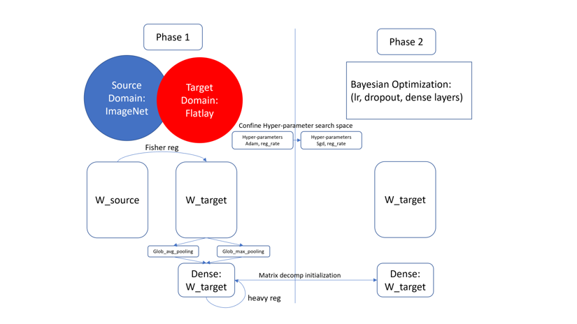

# HyperTuner

Automated hyperparameter tuning for fine-tuning image classification networks
in Keras. Point it at a folder of labelled images and a pretrained backbone;
it searches learning rates, head size and regularization with a grid stage
and Bayesian optimization, and keeps the best models.



> **Status.** Written in 2020 against Keras 2.2.4 on TensorFlow 1.x and not
> maintained since. It is published as a reference implementation. Expect to
> pin old versions (see [Requirements](#requirements)) or port it to
> `tf.keras` yourself.

## Contents

- [Supported backbones](#supported-backbones)
- [Requirements](#requirements)
- [Dataset layout](#dataset-layout)
- [Usage](#usage)
- [Configuration](#configuration)
- [Outputs](#outputs)
- [Adding your own backbone](#adding-your-own-backbone)
- [Method](#method)
- [License](#license)

## Supported backbones

Defined in [`src/load_base_model.py`](src/load_base_model.py); pass the name
to `--backbone`:

- `vgg16`, `vgg19`
- `resnet50`, `resnet101`, `resnet152`
- `xception`, `mobilenet`
- `inceptionv3`, `inceptionresnetv2`
- `densenet121`, `densenet169`
- `nasnetlarge`, `nasnetmobile`
- `EfficientNetB0` to `EfficientNetB4` (default: `EfficientNetB2`)

## Requirements

- Python 3.6 or 3.7
- A CUDA GPU is strongly recommended

Use a virtual environment; the pins are old and conflict with current
packages.

```bash
python3.7 -m venv .venv
source .venv/bin/activate
pip install -r requirements.txt
```

## Dataset layout

One sub-folder per label, images inside:

```
dataset_name/
├── label_a/
│   ├── img001.jpg
│   └── ...
├── label_b/
│   └── ...
└── ...
```

## Usage

```bash
python main.py --dataset path/to/dataset_name \
               --backbone EfficientNetB2 \
               --imgsize 260 \
               --val_split 0.15 \
               --gpu 0,1,2,3 \
               --output_path ./models
```

| Flag | Default | Meaning |
| --- | --- | --- |
| `-d`, `--dataset` | (required) | dataset root, layout above |
| `-bk`, `--backbone` | `EfficientNetB2` | backbone name |
| `-im`, `--imgsize` | `260` | input image size (square) |
| `-v`, `--val_split` | `0.15` | share of the data held out for validation |
| `-b`, `--batch_size` | `32` | batch size |
| `-gpu`, `--gpu` | `0` | GPU ids, comma separated (sets `CUDA_VISIBLE_DEVICES`) |
| `-op`, `--output_path` | `./models` | where models and logs are written |
| `-db`, `--debug` | `False` | debug mode |

[`inference.py`](inference.py) is a minimal example that loads a saved model
and writes predictions for every image in `./test_image` to a JSON file. Set
`MODEL_NAME` at the top of the file first.

## Configuration

The search space and budgets live in [`config.py`](config.py):

```python
BayesConfig = {
    "pbounds": {"global_log_lr": (-6, -3), "neuron_shrink": (0.9, 0.1)},
    "max_dense_layers": 3,
    "bayes_init_points": 5,
    "bayes_num_iter": 25,
    "max_epoch": 15,
    "patience": 3
}

ModelQueueConfig = {
    "queue_size": 5,                        # best models kept for crossover
    "log_lr_grid": [-2.5, -3.0, -3.5, -4.0]
}

GridConfig = {
    "grid_target": 85,                      # validation accuracy (%) to reach
    "conv_reg_l2": [-5, -6],                # log10 of the L2 weight on conv layers
    "dense_reg_l1": [-5, -6],               # log10 of the L1 weight on dense layers
    "patience": 1,
    "max_epoch": 15
}
```

Learning rates and regularization weights are given as log10 values.

## Outputs

Under `--output_path`, one folder per run named by its start time:

- `<start time>/`: saved models, plus `reflection.csv`, the mapping from
  label name to encoded class id, for example:

  | label | encoded |
  | --- | --- |
  | geometric | 0 |
  | tribal | 1 |
  | zebra | 2 |
  | plaid | 3 |

- `<start time>_log/`: TensorBoard logs, including the learning rate.

## Adding your own backbone

Add a branch to [`src/load_base_model.py`](src/load_base_model.py):

```python
if model_name == "MyNet":
    from my_library import MyNet as base
```

then run with `--backbone MyNet`.

## Method

The search runs in two stages. A grid stage fine-tunes the head over a small
learning-rate and regularization grid and fills a queue of the best models.
Bayesian optimization (the
[`bayesian-optimization`](https://github.com/bayesian-optimization/BayesianOptimization)
package) then searches the global learning rate and head size, starting each
trial from a crossover of models in the queue.

What the code implements:

- **Cyclical learning rates** with warm restarts and decay, as a callback
  (`SGDRScheduler` in [`customized_callbacks.py`](src/keras_utils/customized_callbacks.py)).
  Smith, *Cyclical Learning Rates for Training Neural Networks*
  ([arXiv:1506.01186](https://arxiv.org/abs/1506.01186)).
- **Adam to SGD switch**: the dense head converges first with Adam (backbone
  frozen), then the whole network trains with SGD at the searched global
  learning rate. TensorBoard logs Adam's effective step size,
  `lr · √(1 − β₂^t) / (1 − β₁^t)`. Keskar & Socher, *Improving Generalization
  Performance by Switching from Adam to SGD*
  ([arXiv:1712.07628](https://arxiv.org/abs/1712.07628)).
- **L1 / L2 regularization grid** on dense and conv layers (`GridConfig`).
- **Head search**: global average pooling, then up to `max_dense_layers`
  dense layers whose width shrinks by `neuron_shrink`.

Ideas from the original design that are not in the code yet:

- Mixed pooling, `a · MaxPool + (1 − a) · AvgPool` at the last layer.
  Lee et al., *Generalizing Pooling Functions in Convolutional Neural
  Networks: Mixed, Gated, and Tree* ([arXiv:1509.08985](https://arxiv.org/abs/1509.08985)).
- L2-SP regularization, `a‖W‖² + b‖W − W₀‖²` with `W₀` the pretrained
  weights. Li et al., *Explicit Inductive Bias for Transfer Learning with
  Convolutional Networks* ([arXiv:1802.01483](https://arxiv.org/abs/1802.01483)).

## License

Apache License 2.0, see [LICENSE](LICENSE).
